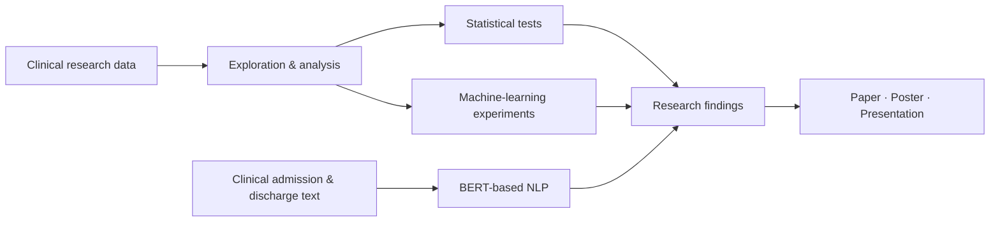

<div align="center">


<br />

# Predicting Hospital Readmissions

### Machine Learning · Clinical NLP · Statistical Research

**Can we identify patterns associated with a patient's return to the hospital?**  
An academic machine learning project exploring hospital readmission prediction through data analysis, classification experiments, and BERT-based processing of clinical text.

<br />


**[Explore the notebooks](notebooks/)** · **[Model experiments](models/)** · **[Scientific paper & poster](Scientific_Article_and_Poster/)**

</div>

---

## The challenge

Hospital readmissions are a meaningful research problem at the intersection of **healthcare, data science, and predictive modeling**. Understanding which patterns may be associated with a patient's return to the hospital can support research into risk assessment and patient outcomes.

This project investigates that challenge using machine learning experiments, statistical analysis, and natural language processing of medical text.

> **Research scope:** This is an academic demonstration, **not** a clinically validated decision-support system. No individual prediction should be used to make medical decisions.

## What you'll find here

<table>
<tr>
<td width="33%" valign="top">

### 🧠 Clinical NLP
Experiments with **BERT** for analyzing admission and discharge text from clinical records.

</td>
<td width="33%" valign="top">

### 📊 Statistical analysis
Notebooks, statistical tests, and visualizations for studying the available research results.

</td>
<td width="33%" valign="top">

### 🔬 ML experimentation
Model training artifacts, evaluation outputs, logs, and classification reports.

</td>
</tr>
</table>

### Research workflow at a glance



*This diagram summarizes the repository's research areas; it is not a claim that every notebook runs in one automated pipeline.*

## Repository guide

| Location | Contents |
| :-- | :-- |
| [`models/`](models/) | Training and evaluation notebooks, classification reports, and experiment logs (including JSON, TSV, and TensorBoard artifacts). |
| [`notebooks/`](notebooks/) | Exploratory analysis and statistical notebooks organized by research topic. |
| [`NLP/`](NLP/) | BERT-related notebooks analyzing clinical admission and discharge text. |
| [`Statistical tests_Updates/`](Statistical%20tests_Updates/) | Visualizations and outputs from statistical tests, with links to related analyses. |
| [`Presentation_and_Summary/`](Presentation_and_Summary/) | Project presentation and research summary. |
| [`Scientific_Article_and_Poster/`](Scientific_Article_and_Poster/) | Scientific article and accompanying academic poster. |
| `requirements.txt` | Python package dependencies. |

## Getting started

### Requirements

- Python **3.8 or newer**
- Jupyter Notebook
- Packages listed in `requirements.txt`

### Setup

```bash
# Clone the personal portfolio repository after it has been published
 git clone https://github.com/RanAlmagor/Hospital-Readmission-Prediction.git
 cd Hospital-Readmission-Prediction

# Optional: create an isolated environment
python -m venv .venv

# Activate it (macOS / Linux)
source .venv/bin/activate
# On Windows: .venv\Scripts\activate

# Install Python dependencies
pip install -r requirements.txt

# Open the notebook environment
jupyter notebook
```

Browse the notebooks in `notebooks/`, `NLP/`, or `models/` to explore the relevant analyses and experiments.

**Important:** The public version does not distribute confidential patient-level data. Some notebooks or training steps may require separately authorized data access or supporting files and might not run end-to-end with the public repository alone.

## Research outputs

This repository contains supporting material for the academic study:

- **Analysis notebooks** — exploration, modeling, and statistical investigation.
- **Training and evaluation artifacts** — experiment outputs and classification reports.
- **Research presentation** — summary of the project and its findings.
- **Scientific article and poster** — written and visual communication of the research.

To assess the actual model performance, consult the **classification reports and research artifacts** in the repository. Performance numbers are intentionally not quoted here until their final versions have been verified.

## Data privacy and responsible use

Patient confidentiality is essential. **Sensitive medical records and identifiable patient data are excluded** from the public demonstration.

- Do not commit patient records, credentials, or protected clinical files.
- Obtain permission before accessing any restricted dataset.
- Treat findings as academic research, not clinical recommendations.

## About this portfolio

**Ran Almagor** · B.Sc. in Computer Science  
[GitHub profile](https://github.com/RanAlmagor)

This is my personal portfolio presentation of an academic capstone project to which I made substantial technical contributions. **The original academic project was collaborative**; its original research authorship and contributor history should remain preserved in the underlying artifacts and Git history.

The public demo from which this portfolio version originates is available [here](https://github.com/ReutTamam/DataFinalProjectDegree-Demo).

---

<div align="center">

<sub>Exploring how machine learning and clinical text analysis can advance research into hospital readmission risk.</sub>

</div>
